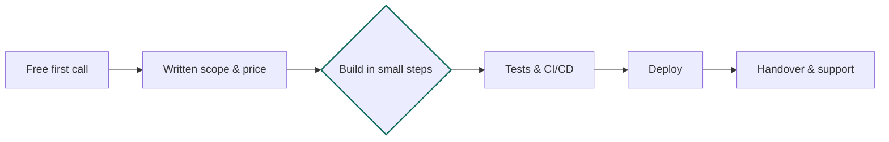

# Marco Maigua

**Software Engineer · Freelance & Consulting**

*Auth0 identity, AI agents and blockchain — from Montreal, in English, French and Spanish.*

---

## 👋 About me

Software engineer based in **Montreal, Canada 🇨🇦**, with **over 10 years** in software development and an **MSc in Computer Science** (University of Saskatchewan).

I have worked in startups, large enterprises and consulting:

- 🔐 **Auth0 / SSO at Desjardins** — OIDC, SAML and MFA flows, Auth0 Actions, tenants deployed with Terraform through GitHub Actions, Node.js services on OpenShift. All of it in French.
- 🛡️ **Auth0 Universal Login at Okta** — authentication policies and middleware in Node.js, reviewed by senior Okta engineers.
- ⛓️ **Tech lead at ChainMyne** — architecture of a crypto exchange: Next.js, React, React Native, AWS Nitro Enclaves, Fireblocks.
- 🐍 **Python back end at Anuvu** — data delivery for in-flight entertainment systems, Redis, AWS S3/SQS, Jenkins, Grafana.

---

## 🧰 What I offer

| Service | What it covers | Price |
| :--- | :--- | :--- |
| 🤖 **AI automation & agents** | Agentic workflows with MCP connectors, scheduled agent runs, human-in-the-loop approval, RAG chatbots | from $1,500 CAD |
| 🔐 **Auth0 & identity (IAM)** | SSO with OIDC/SAML, MFA, Auth0 Actions, Universal Login, Terraform-managed tenants, SAML→OIDC migrations | from $2,000 CAD |
| ⛓️ **Blockchain development** | Solidity smart contracts (ERC-20, ERC-721), Ethereum & Solana integrations, tests with Hardhat/Truffle | from $3,000 CAD |
| 🧩 **Full-stack apps** | React, Next.js, React Native, Node.js and Python apps, REST APIs, AWS and Docker deployment | from $6,000 CAD |

➡️ Full details, packages and contact form: **[nemesis1346.github.io/self-promotion](https://nemesis1346.github.io/self-promotion/)** — the first call is free.

---

## 🚀 Main stack

| Domain | Technologies | Focus |
| :--- | :--- | :--- |
| **Identity & Security** |     | SSO, MFA, Actions, token claims |
| **AI & Agents** |     | Agents, RAG, MCP connectors, human approval |
| **Front-end** |      | Web and mobile apps |
| **Back-end** |     | REST APIs, middleware, automation |
| **Blockchain** |     | Smart contracts, DEX data, wallets |
| **Data** |     | Schemas, migrations, caching |
| **Cloud & DevOps** |        | Infrastructure as code, CI/CD |
| **Observability** |     | Metrics, logs, auth monitoring |

---

## 🎓 Education

- **MSc in Computer Science** — University of Saskatchewan. Thesis on digital asset distribution with Ethereum and Hyperledger Fabric.
- **BSc in Electrical Engineering** — Universidad San Francisco de Quito.

---

## 🛠️ How I work

---

### 📫 Availability

  

**Base:** Montreal, Quebec, Canada 🇨🇦 · Eastern Time · Remote
 
**Languages:** English · Français · Español

